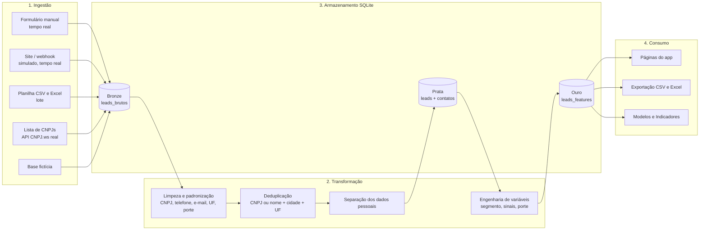
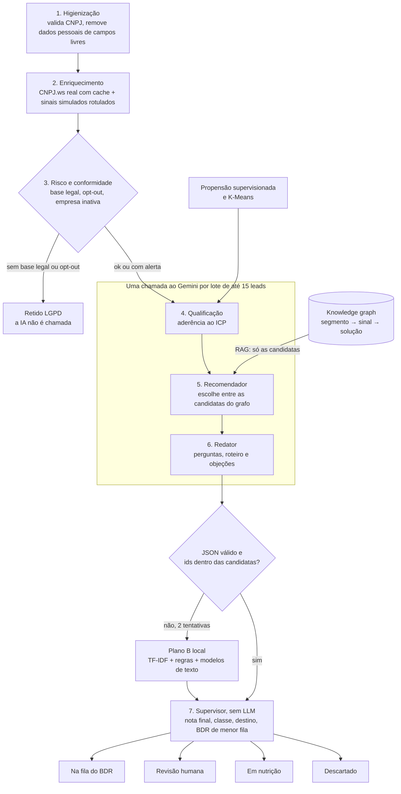
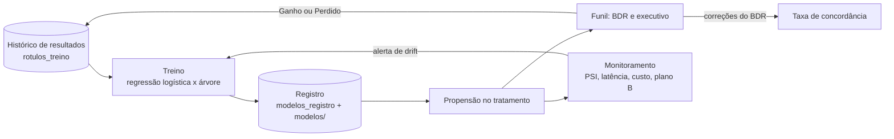

# Arquitetura do Fullguete

O Fullguete é um protótipo em Streamlit que leva o lead da captura ao fechamento. A IA qualifica, recomenda a
solução Equifax e escreve o roteiro; o BDR decide; o resultado do funil volta para o modelo aprender.

## 1. Pipeline de dados em 4 etapas

Toda origem passa por `dados/ingestao.py`: grava o registro como chegou (bronze), aplica as regras de entrada
(campo obrigatório, deduplicação e base legal), cria o lead limpo (prata) e separa nome, e-mail e telefone do
contato na tabela `contatos`. As variáveis do modelo (ouro) são geradas pelo Agente de Enriquecimento.

## 2. Fluxo de agentes do tratamento

Regras que o orquestrador (`ia/orquestrador.py`) garante:

- Nenhum agente envia mensagem nem muda etapa por conta própria. Só o Supervisor grava o destino, por regras.
- Nome, e-mail, telefone e localização nunca vão para o LLM (há teste automatizado para isso).
- Cada etapa de cada lead fica em `tratamento_etapas`, e cada chamada em `eventos_ia`.

## 3. Ciclo de MLOps

O histórico começa com 500 leads sintéticos. Cada Ganho ou Perdido do funil entra como exemplo novo, e o botão
"Retreinar com os resultados do funil" (Indicadores) registra uma versão nova e ativa a de maior AUC.

## 4. Camada, tecnologia e arquivo

| Camada | Tecnologia | Arquivo |
|---|---|---|
| Interface e navegação | Streamlit (`st.navigation`) | `app.py`, `paginas/`, `estilo/tema.css`, `.streamlit/config.toml` |
| Login e perfis | PBKDF2 (hashlib) | `nucleo/auth.py` |
| Configuração e segredos | python-dotenv, Secrets do Streamlit | `nucleo/config.py`, `.env.example` |
| Ingestão | Pandas, Requests | `dados/ingestao.py`, `dados/cnpjws.py` |
| Transformação | Pandas, regex | `dados/limpeza.py`, `dados/cnpj.py`, `dados/features.py` |
| Armazenamento | SQLite com migrações | `banco/esquema.sql`, `banco/migracoes/`, `banco/conexao.py` |
| Máquina de estados | Python | `nucleo/estados.py` |
| Agentes e orquestração | Python | `ia/agentes.py`, `ia/orquestrador.py` |
| LLM | Google Gemini (google-genai) | `ia/provedor.py` |
| Prompts versionados | Markdown + few shot | `prompts/v1/` |
| Saída estruturada | Pydantic | `ia/esquemas.py` |
| RAG e knowledge graph | NetworkX, scikit-learn (TF-IDF) | `ia/grafo.py`, `ia/rag.py`, `catalogo/regras_grafo.json` |
| Nota local e plano B | scikit-learn (TF-IDF) | `ia/score_local.py`, `ia/plano_b.py` |
| Supervisionado | scikit-learn (LogisticRegression, DecisionTree) | `ia/propensao.py` |
| Não supervisionado | scikit-learn (KMeans) | `ia/segmentos.py` |
| Observabilidade e drift | SQLite, NumPy (PSI) | `ia/observabilidade.py`, `ia/drift.py` |
| Comercial e LGPD | Python | `nucleo/comercial.py`, `nucleo/revisao.py`, `nucleo/lgpd.py` |
| Indicadores | Pandas, Plotly | `banco/metricas.py`, `paginas/indicadores.py` |
| Qualidade e CI | pytest, ruff, GitHub Actions | `tests/`, `pyproject.toml`, `.github/workflows/ci.yml` |

## 5. Estados do lead

`Capturado → Em tratamento → Tratado → (Na fila do BDR | Em nutrição | Revisão humana | Descartado | Retido LGPD)
→ Em contato → Qualificado → Reunião marcada → Proposta → Ganho | Perdido`

As transições permitidas estão em `nucleo/estados.py`. Toda mudança grava quem, quando, de onde, para onde e o
motivo. Perdido e Descartado exigem motivo da lista. Com opt-out, nenhuma etapa de contato é aceita.

## 6. Custo de escala

- Modelo leve por padrão (`GEMINI_MODEL=gemini-3.1-flash-lite`), configurável.
- Até 15 leads por chamada (`tamanho_lote_ia`), com uma única chamada para qualificação, recomendação e redação.
- Cache por empresa: a mesma empresa, com o mesmo prompt, ICP e candidatas, não paga duas vezes.
- Leads retidos por LGPD não chegam ao LLM.
- Custo por lead e por 1.000 leads visível em Indicadores. No teste real, 6 leads custaram US$ 0,0025 em 11 s.
