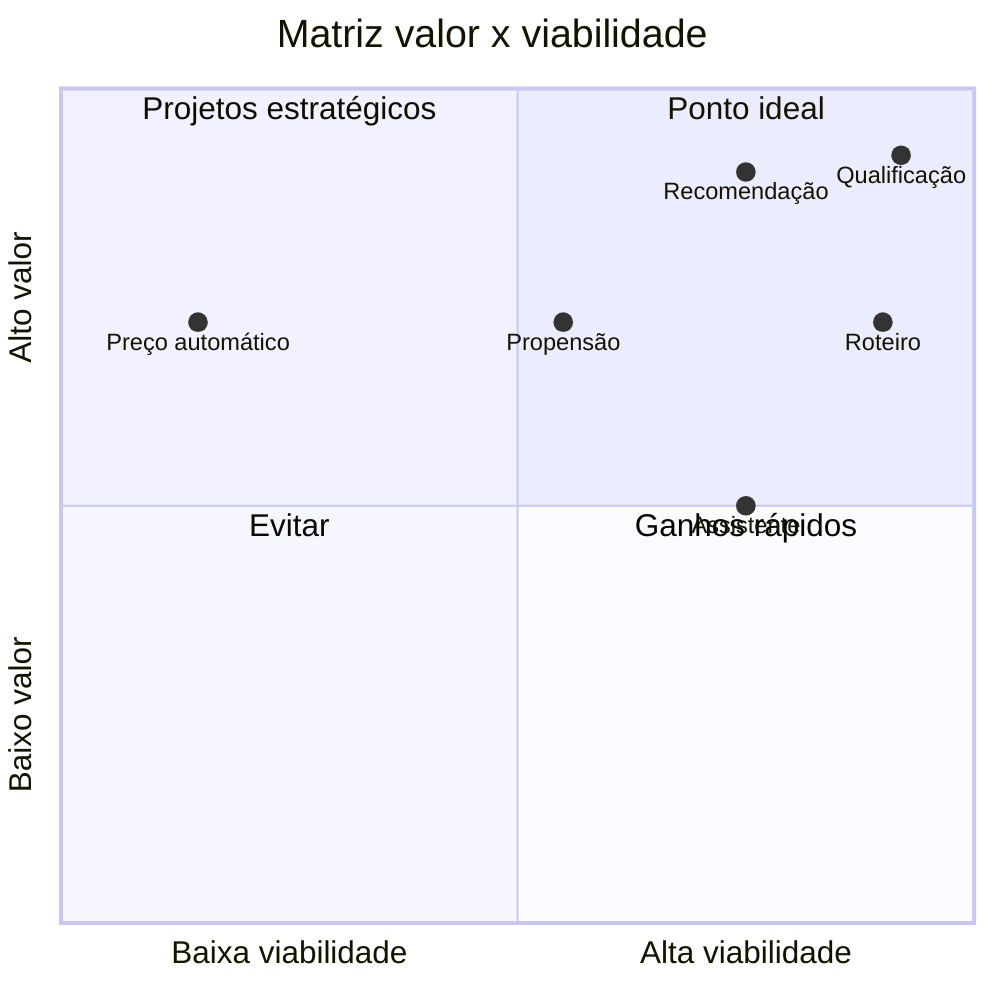

# Estratégia de IA do Fullguete

## 1. Negócio em primeiro lugar

**Objetivo:** aumentar a receita com soluções B2B da Equifax Brasil e a produtividade do BDR.
A IA é o meio: ela qualifica cada empresa, diz qual solução faz sentido e por quê, e entrega ao BDR uma fila
priorizada com roteiro de abordagem. Quem decide e fala com o cliente é sempre uma pessoa.

**Fontes de valor da IA:**

| Fonte de valor | Como o Fullguete gera |
|---|---|
| Crescimento de receita | Recomendação da solução certa (e das complementares) para cada lead, com o caminho no grafo que a justifica |
| Eficiência operacional | Fila priorizada por nota e SLA, roteiro por canal pronto, resumo automático na passagem ao executivo |
| Gestão de risco e compliance | Base legal checada antes de qualquer contato, opt-out, minimização de dados, trilha de auditoria completa |

## 2. Casos de uso e matriz valor x viabilidade

Notas de 1 a 5, discutidas pelo grupo. Viabilidade considera dados disponíveis, esforço e risco.

| Caso de uso | Valor | Viabilidade | Quadrante |
|---|---|---|---|
| Qualificação do lead (nota de aderência ao ICP) | 5 | 5 | Ponto ideal |
| Recomendação da oferta Equifax | 5 | 4 | Ponto ideal |
| Roteiro de abordagem por canal | 4 | 5 | Ponto ideal |
| Previsão de conversão (propensão) | 4 | 3 | Investir com cuidado (dados sintéticos no início) |
| Assistente comercial (chat com o catálogo) | 3 | 4 | Ganho rápido |
| Preço e proposta automáticos | 4 | 1 | Fora do MVP |

**Ponto ideal escolhido para o MVP:** qualificação + recomendação + roteiro, em um único fluxo de agentes, porque
combinam o maior valor com dados que já existem (cadastro da empresa, CNPJ.ws, catálogo). A propensão entra
desde já para mostrar o ciclo de aprendizado, com o aviso de que começa em dados sintéticos.

## 3. KPIs, OKRs e história de valor

**OKR do trimestre (protótipo):**

- **Objetivo:** transformar a prospecção da Equifax em um processo previsível e explicável.
  - KR1: tempo mediano até o primeiro contato de leads Quentes abaixo de 4 horas.
  - KR2: conversão de Com o BDR para Reunião acima de 40%.
  - KR3: concordância do BDR com a IA acima de 80%.
  - KR4: 100% dos contatos com base legal registrada.

**KPIs na página Indicadores** (operacional ligado a negócio):

| Operacional | Leva a | Negócio |
|---|---|---|
| Tempo até o primeiro contato, cumprimento de SLA | mais conversas com leads quentes | Reuniões |
| Conversão por etapa, por BDR, origem e solução | foco no que fecha | Ganhos |
| Concordância BDR x IA, uso do plano B | confiança na recomendação | Receita prevista do funil |
| Custo por lead tratado | escala sustentável | Margem da operação |

**História de valor** (narrativa com dados, recomendação do Gartner vista em aula): "Antes, o BDR recebia uma
lista sem ordem e perdia tempo com empresas sem fit. Com o Fullguete, cada empresa chega com nota explicada, a
solução Equifax mais provável e um roteiro pronto. O BDR liga primeiro para quem tem mais chance, no prazo do SLA,
e cada resultado ensina o modelo. Em Indicadores mostramos o efeito: menos horas até o primeiro contato, mais
reuniões por BDR e a receita prevista do funil crescendo."

## 4. Roadmap em fases

| Fase | O que entrega | Marcos | O que muda |
|---|---|---|---|
| **1. Exploração (este MVP)** | Fluxo completo com dados fictícios e CNPJ.ws real; IA generativa com plano B; propensão em dados sintéticos | Demo de ponta a ponta; testes e CI verdes; feedback do professor | Validar valor com o time comercial, sem integração real |
| **2. Desenvolvimento e Escalonamento** | Integração com CRM e fontes de dados reais da empresa; primeiros meses de rótulos reais; SSO; banco gerenciado | Modelo retreinado só com resultados reais; SLA medido em produção; custo por lead sob meta | Sai de PoC para operação; MLOps com retreino agendado e alertas de drift |
| **3. Maturidade e Otimização** | Testes A/B de roteiros, ajuste fino de pesos por segmento, agentes com mais autonomia supervisionada | Ganho de conversão medido contra grupo controle; governança com comitê | IA integrada ao fluxo de trabalho, aprendizado contínuo e CoE apoiando outras áreas |

## 5. Maturidade de IA

Autoavaliação curta no modelo de maturidade de IA do Gartner (cinco níveis: Consciência, Ativo, Operacional,
Sistêmico e Transformacional).

| Dimensão | Atual | Meta em 12 meses |
|---|---|---|
| Estratégia | Nível 2, Ativo: caso de uso claro e patrocínio da área comercial | Nível 3, Operacional |
| Dados | Nível 2: dados de cadastro e catálogo; histórico sintético | Nível 3: histórico real do funil e CRM integrado |
| Tecnologia | Nível 2: protótipo com LLM, grafo e ML clássico | Nível 3: pipeline em produção com monitoramento |
| Pessoas e processos | Nível 2: BDR revisa e corrige a IA | Nível 3: rotina de revisão e metas por OKR |
| Governança | Nível 3: LGPD, XAI e auditoria desde o início | Nível 4: comitê e políticas formais |

**Resumo:** hoje o projeto está entre Ativo e Operacional. A meta é Operacional em 12 meses, com o CoE de IA
apoiando a expansão para outras linhas (por exemplo, carteira e cobrança).
